##**Дипломный проект курса "Android-разработчик с нуля"**

### Приложение "NeWork" - социальная сеть с ориентацией на профессиональную деятельность

#### Описание:

**Основные функции приложения**:
- Регистрация и авторизация

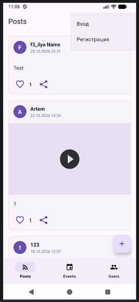
- При клике по иконке фотоаппарата на экране регистрации можно выбрать аватар для профиля
- На экране авторизации в поле для ввода пароля, вводимое значение по умолчанию скрыто
- При клике на иконку в виде глаза в конце поля для ввода пароля введенные значения открываются для просмотра

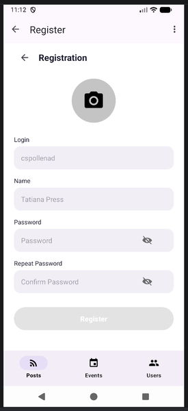 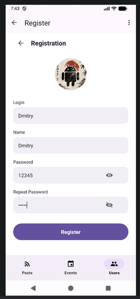
- При вводе неправильного пароля внизу экрана появляется тост с уведомлением об ошибке авторизации

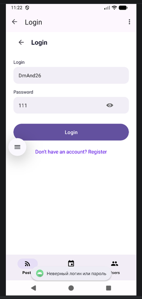
- При попытке неавторизованного пользователя взаимодействовать с лентой постов, появляется всплывающее окно в предложением зарегистрироваться или авторизоваться. Ссылки перенапрявляют на соответствующие экраны приложения

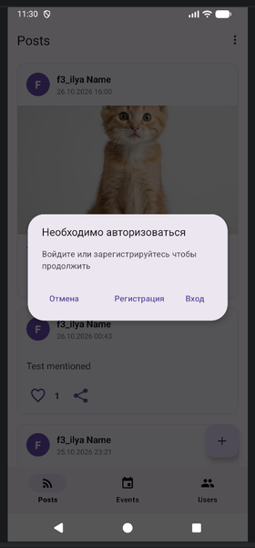
- Для авторизованного пользователя доступны следующие действия:
	- Поставить "лайк" посту. При этом цвет иконки лайков(сердечко) меняется на иконку с заливкой, а счетчик лайков увеличивается на единицу;
	- Поделиться постом. При этом открывается окно с выбором приложений где можно поделиться постом;
	- Создание нового поста при клике на кнопку (FAB) в правом нижнем углу общей ленты постов;
	- Создание нового поста предполагает: текстовую часть, добавление фотографии с камеры телефона, добавления медиа-вложения (изображение, видео, аудио), упоминания пользователей (при этом открывается новый экран выбора пользователей), добавление локации;
	
	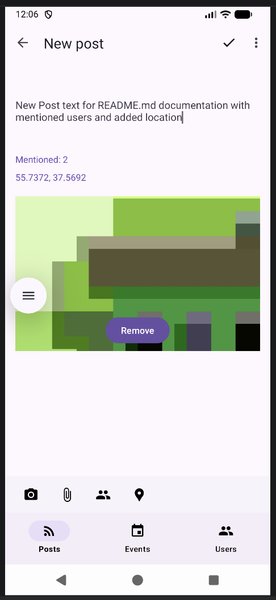 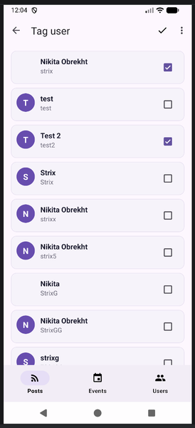 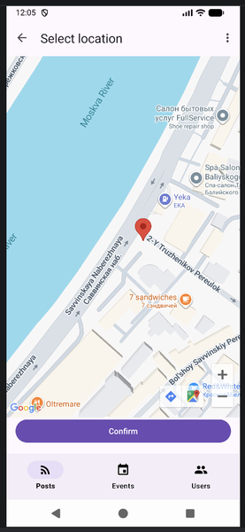 
	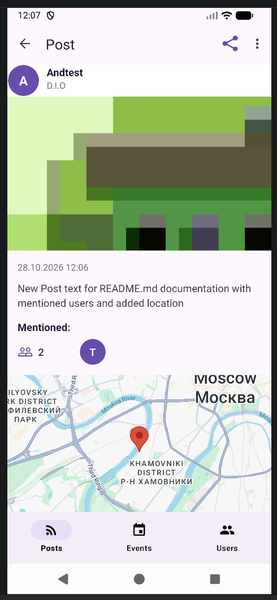
	
	- Редактирование собственного поста;

	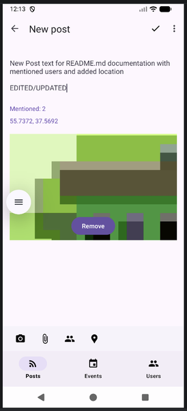 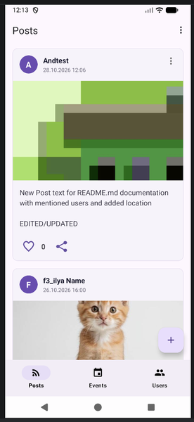
		
	- Удаление собственного поста;
	- Создание события (перейдя на вкладку Events, клик по кнопке (FAB) в правом нижнем углу)
	- Создание события предполагает: текстовую часть, добавление фотографии с камеры телефона, добавления медиа-вложения (изображение, видео, аудио), упоминания пользователей (при этом открывается новый экран выбора пользователей), добавление локации, выбор типа события (онлайн/офлайн) и даты события;
	- Редактирование собственного события;
	- Удаление собственного события;
	

